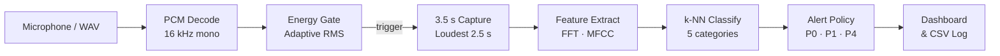

# OmniEar

**Real-time sound classification for Java** — capture audio, extract features and classify events into five categories, all with zero external dependencies.

[](https://adoptium.net/temurin/releases/?version=21)
[]()

<p align="center">
  
</p>

## Overview

OmniEar is an offline Java desktop application that listens to audio input, detects energy anomalies and classifies captured sounds using a lightweight k-NN model trained on 170 real recordings. It explores how a complete acoustic-monitoring pipeline — from microphone capture to severity-based alerts — can be built with nothing beyond the standard JDK.

> **Note:** OmniEar is an academic prototype. Direct WAV classification works with the bundled model; continuous live detection remains experimental and can miss events or raise false alerts. This is not an emergency-response system.

## Features

- **Audio monitoring** — live microphone capture with adaptive energy-gate detection
- **Sound classification** — Java FFT/MFCC feature extraction → k-NN inference over five categories
- **Severity-based alerts** — P0 Critical, P1 High, P4 Monitoring; background noise is suppressed
- **Waveform display** — real PCM amplitude visualization for every classified event
- **Training management** — bundled 170-WAV model with support for custom imports and validation
- **Event history** — durable CSV-backed log with timestamps, predictions, scores and outcomes
- **Classroom Demo** — one-click guided playback of five curated recordings, no microphone needed

## Quick Start

**Requirements:** Git, JDK 21 (full JDK, not JRE), graphical desktop.
No Maven, Gradle, Python or third-party libraries required.

```sh
git clone https://github.com/milan-kb/OmniEar-Java.git
cd OmniEar-Java
java Build.java jar
java -jar build/OmniEar.jar --demo
```

The `--demo` flag opens a self-contained Classroom Demo window with five prerecorded sounds. For the full application with microphone monitoring, launch without `--demo`:

```sh
java -jar build/OmniEar.jar
```

## How It Works



## Technology

| Layer | Implementation |
|---|---|
| Language | Java 21 — no runtime or build dependencies |
| UI | Swing with dark theme |
| Audio I/O | Java Sound API (capture & playback) |
| Features | FFT, MFCC, temporal pooling |
| Classifier | k-NN with standardized feature vectors |
| Storage | Quoted UTF-8 CSV with process locking |
| Build | Single-file `Build.java` — compile, test, package |

## Classroom Demo

The demo classifies five genuine recordings through the real model and alert policy:

| # | Recording | Category | Priority |
|---|---|---|---|
| 1 | Acted scream | Distress scream | P0 Critical |
| 2 | Distant explosion | Explosion | P0 Critical |
| 3 | Glass breaking | Impact / crash | P1 High |
| 4 | Traffic siren | Siren | P4 Monitoring |
| 5 | Street rain | Background noise | Suppressed |

Launch with `java -jar build/OmniEar.jar --demo`. Each recording plays through your speakers while the classifier runs independently on the decoded audio. Results include waveform, vote share, priority and a persistent event log.

> **Important:** These five recordings are deliberately selected successes. They demonstrate the pipeline, not general model accuracy.

## Documentation

| Guide | Description |
|---|---|
| [Getting Started](docs/GETTING_STARTED.md) | JDK 21 setup on Windows, macOS and Linux |
| [Architecture](docs/ARCHITECTURE.md) | Source map, data flow and threading model |
| [Demo Guide](docs/DEMO.md) | Detailed classroom presentation instructions |
| [Testing](docs/TESTING.md) | Regression suite, WAV evaluation and CLI tools |
| [Contributing](CONTRIBUTING.md) | Branch workflow, PR process and code standards |
| [Project Report](docs/PROJECT_REPORT.md) | Academic narrative and design rationale |
| [Datasets](DATASETS.md) | Recording selection, licensing and provenance |

## Limitations

- **Live detection is unreliable** — the energy-gate and k-NN pipeline can miss events and produce false alerts in uncontrolled environments.
- **Narrow training data** — 170 recordings; screams are mostly acted, impacts are mainly glass/ceramic. Labels do not prove real distress or vehicle crashes.
- **Not a safety system** — no SMS, remote dispatch, alarm hardware, neural network or network service is included.
- **Tested on Linux/JDK 21** — Windows and macOS should work but have not been extensively verified.

## Credits

OmniEar-Java is a from-scratch Java 21 reimplementation inspired by the [original OmniEar](https://github.com/milan-kb/OmniEar) Python/YAMNet prototype. The Java version replaces the neural pipeline with handcrafted FFT/MFCC features and k-NN classification using only standard JDK APIs.

Training and evaluation recordings are sourced from [Freesound](https://freesound.org/) (FSD50K), [SoundScalpel](https://soundscalpel.com/) and [YLE Arkisto](https://yle.fi/) under CC BY, CC0 and equivalent licenses. Full per-recording attribution is in [`datasets/ATTRIBUTION.md`](datasets/ATTRIBUTION.md).
