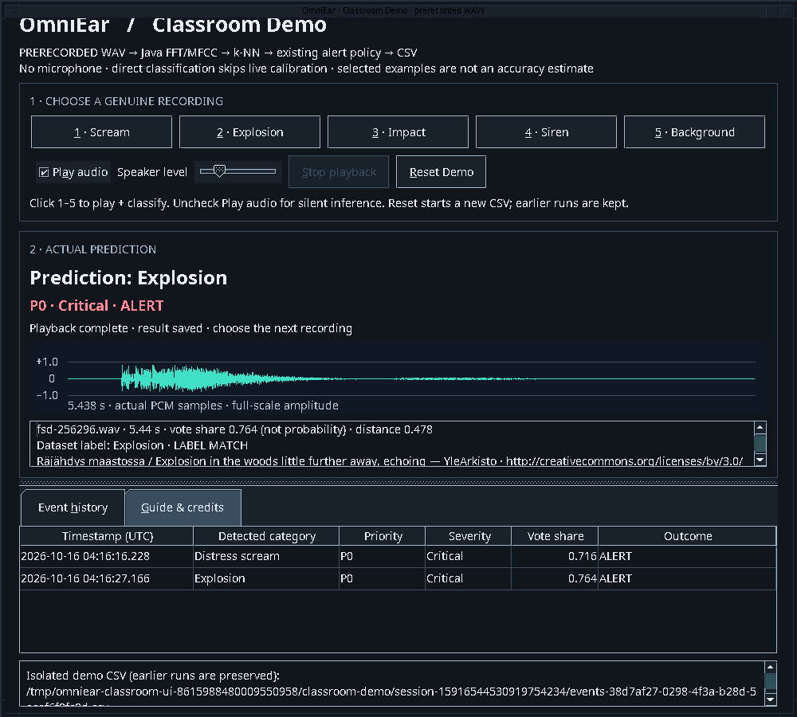
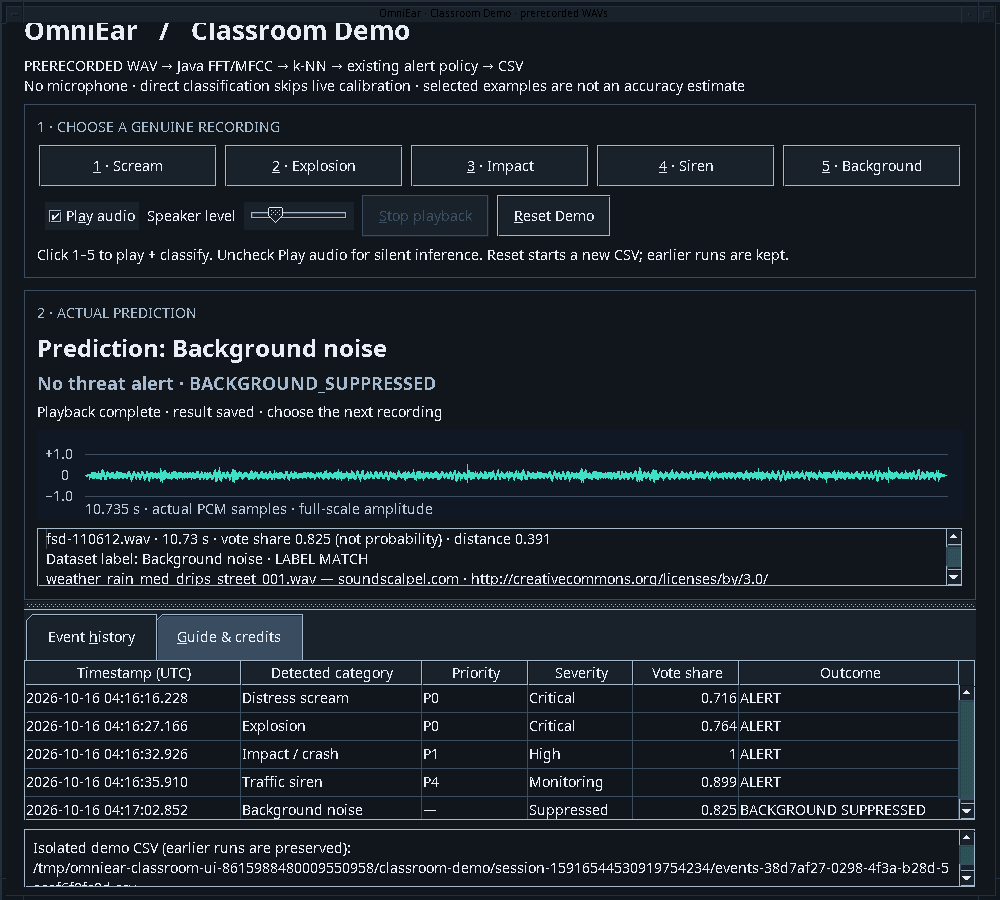

# Five-minute classroom demo

[START HERE](../README.md) · [Architecture](ARCHITECTURE.md) · [UML](UML.md) · [Tests](../TEST_RESULTS.md)

**Demonstrate five selected genuine recordings with the existing Java classifier.**
Classroom Demo plays the prerecorded WAV, computes its prediction, applies the
existing alert policy and saves the actual result. It does not listen to the
microphone, fake an alert or use the dataset label to make a prediction.
These deliberately selected successes **are not general model accuracy**.

## Clone, build, launch

Full JDK **21**, Git and a graphical desktop are required. A speaker/headphone
output is needed for sound; no microphone setup, external datasets, Python,
Maven, network model download or third-party Java dependencies are needed.

```sh
git clone --branch feat/classroom-demo https://github.com/milan-kb/OmniEar-Java.git
cd OmniEar-Java
java -version
javac -version
java Build.java test
java Build.java jar
java -jar build/OmniEar.jar --demo
```

Tests end with **`PASS: 308 checks`**. Wait for **Ready · choose recording 1 to
begin**. The demo loads the unchanged **170-WAV** bundled model. Select a modest
OS speaker volume; the demo's speaker slider defaults to 25% and affects only
playback, never the waveform, classifier input or saved RMS.

You can also use **Classroom Demo…** in the existing Dashboard (Alt+5). The
ordinary application and its four original tabs remain available without
`--demo`. Close/stop ordinary microphone monitoring before presenting; the
classroom window itself never opens a recording input.

### Portable JAR only

Copy just `build/OmniEar.jar` to another folder or a teammate's machine with Java
21 and run:

```sh
java -jar OmniEar.jar --demo
```

All five demonstration WAVs, original training, and licenses are inside the JAR.
No repository-relative audio path is used. To choose a writable data location:

```sh
java -jar OmniEar.jar --demo --data classroom-data
```

Do not supply `--training`: Classroom Demo intentionally uses its own fresh
bundled training to avoid old/custom-model changes during a presentation.

## Five-minute sequence

| Time | Action | Explain/show |
|---|---|---|
| 0:00–0:30 | Launch `--demo`, wait for Ready. | “These are prerecorded, selected WAVs. Java computes every prediction now; this is not live detection.” |
| 0:30–1:00 | Click **1 · Scream** (Alt+1). | Hear the 9.52 s recording; show **Distress scream**, **P0 / Critical**, waveform and first CSV-backed event. |
| 1:00–1:20 | Click **2 · Explosion** (Alt+2). | 5.44 s recording; **Explosion**, **P0 / Critical**. |
| 1:20–1:40 | Click **3 · Impact** (Alt+3). | 2.71 s glass breakage; **Impact / crash**, **P1 / High**. Do not call it a vehicle collision. |
| 1:40–2:15 | Click **4 · Siren** (Alt+4). | 26.69 s recording; **Traffic siren**, **P4 / Monitoring**. |
| 2:15–2:40 | Click **5 · Background** (Alt+5). | 10.73 s rain; **Background noise**, **No threat alert / BACKGROUND_SUPPRESSED**. The suppressed event still enters history/CSV. |
| 2:40–3:10 | Repeat **3 · Impact**. | A fresh computation and exactly one additional event. Controls prevent overlapping/double-click runs. |
| 3:10–3:45 | Show history and copy the CSV path at the bottom. Click **Reset Demo** (Alt+R), then Background again. | Empty new history/CSV, then one real suppressed background result. Earlier CSVs remain intact. |
| 3:45–4:30 | Open **Guide & credits** (Alt+G). | Show source author/license. Explain real FFT/MFCC → k-NN → AlertPolicy → EventStore; weighted votes are not probabilities. |
| 4:30–5:00 | Show [UML](UML.md) and [architecture](ARCHITECTURE.md). | `AudioSource` abstraction / `PcmSource` inheritance, `SoundClassifier` polymorphism, immutable records, composition, worker vs EDT and `AutoCloseable` resources. State limitations. |

You can keep speaking during playback. Inference and durable CSV append finish
first; the displayed result remains visible while the actual WAV plays. Alerts
are local categories/severity metadata, not a separate alarm sound or dispatch.
The waveform is the actual complete decoded recording, not a generated animation
or microphone trace.

## Verified clip outcomes — unchanged stable-main classifier

Audited all ten previously bundled samples. Selected the five correctly
classified recordings already licensed and packaged independently of training;
no audio was cropped, synthesized, relabeled or added to training.

| Button / source | Actual prediction | Existing routing | Vote share | Distance | License / author |
|---|---|---|---:|---:|---|
| [264918](https://freesound.org/s/264918/) | Distress scream | P0 / Critical / ALERT | .716172 | .980568 | CC BY 3.0 · AderuMoro |
| [256296](https://freesound.org/s/256296/) | Explosion | P0 / Critical / ALERT | .764136 | .477744 | CC BY 3.0 · YleArkisto |
| [320167](https://freesound.org/s/320167/) | Impact / crash | P1 / High / ALERT | 1.000000 | .465799 | CC0 · joshs |
| [238228](https://freesound.org/s/238228/) | Traffic siren | P4 / Monitoring / ALERT | .899236 | .612103 | CC0 · eaglechopper |
| [110612](https://freesound.org/s/110612/) | Background noise | NONE / BACKGROUND_SUPPRESSED | .824735 | .391419 | CC BY 3.0 · soundscalpel.com |

Exact authors/licenses for all clips, original metadata and SHA-256 hashes:
[catalog](../demo/samples.tsv), [attribution](../datasets/ATTRIBUTION.md),
[manifest](../datasets/manifest.json). Credits are also shown inside the app/JAR.
Recorded repeat-run outcomes: [CLASSROOM_RESULTS.tsv](../demo/CLASSROOM_RESULTS.tsv).
All five source recordings are separate from training and have nonzero nearest
distances. This is a curated reproducibility demonstration, not a blind test.

The other five bundled examples remain in normal **WAV Testing**, including
wind → false scream. Their original [verified outcomes](../demo/VERIFIED_RESULTS.tsv)
are preserved. Classroom Demo's one selected background stays suppressed; that
does **not** mean arbitrary background recordings are safe from false alerts.

## Portable sound-testing package

`OmniEar-Demo-Soundset.zip` packages the ten audited recordings — the five
verified above in `wav/` and the five known-limitation examples in
`known-limitations/` — with a beginner [testing guide](../demo/soundset/TESTING_GUIDE.md),
a [checklist](../demo/soundset/CHECKLIST.md) and a full
[manifest](../demo/soundset/manifest.tsv) of labels, licenses, expected
predictions, severity, alert behavior and SHA-256. Rebuild it from the repository
root with `java scripts/PackageSoundset.java`; re-verify the built ZIP against
the packaged JAR with `python3 scripts/verify_soundset.py` (the verifier, unlike
the app itself, needs Python 3). Both pass on the recorded evidence.

## Screenshots from actual Swing runs





The minimum demo window is 1000×900; use a desktop/projector that accommodates it,
or reduce OS display scaling. Panes scroll and the result/history divider moves.
Use Tab and Alt+1…5 / Alt+A / Alt+S / Alt+R for keyboard operation. Severity is
shown as text as well as color. No assistive-technology certification is claimed.

## Reset, persistence and recovery

- **Reset Demo** is available when idle. It starts a new empty CSV and clears
  the waveform/result/history without retraining. It never truncates earlier
  CSVs or deletes normal user data. Stop playback first if a clip is playing.
- Each launch makes a fresh `data/classroom-demo/session-…/` containing its own
  170-file training copy and `events-….csv`. Earlier rehearsal files remain for
  inspection, including after closing/restarting. A new window starts empty
  deliberately; it does not silently import previous demo history. The exact
  current CSV path is selectable/copyable at the bottom. Normal `data/events.csv`
  and custom training are never modified by this mode.
- **No sound:** choose/unmute the OS playback device, check speaker level and
  retry. An unavailable output is explicitly reported; the real prediction and
  saved result remain. Uncheck **Play audio** (Alt+A) for silent classification.
  Java Sound delivery cannot establish that the room's speakers are audible.
- **Stop playback** (Alt+S) releases output; the already computed/saved result
  stays. It does not rerun inference or add a fake cancellation event. Repeat
  a button after completion to generate a new genuine result.
- **Startup/CSV error:** the app reports failure rather than calling it saved.
  Close and relaunch with a writable `--data` directory. A reset creates another
  CSV; original files remain. No microphone permission is relevant to this mode.
- **Unexpected label:** show the actual mismatch, not the catalog label as the
  prediction. Use a freshly built stable classroom JAR; do not use experimental
  acoustic branches or custom model data to reproduce these outcomes.

## Rehearsal checks

```sh
java Build.java test
java Build.java ui-test
java Build.java jar
java -ea -cp build/OmniEar.jar omniear.TestSuite
java -cp build/OmniEar.jar omniear.ClassroomDemoTest
java -cp build/OmniEar.jar omniear.ClassroomUiTest
```

The last command **plays the five WAVs** and needs a graphical desktop and output
device. It checks actual playback completion, real inference, severity, no
background alert, native Reset Demo click, keyboard control, repeat/stop/close,
startup isolation and durable CSV reopen. It never opens the microphone. On
KDE/Wayland a compositor may refuse Robot focus; use the existing rootful Xwayland
procedure in [TEST_RESULTS.md](../TEST_RESULTS.md) rather than skipping assertions.

Verified on Linux/JDK 21, including a fresh clone and JAR-only execution outside
the repository. Windows/macOS output devices need a local rehearsal. Live
microphone detection remains unreliable; its original calibration and all
classifier/alert semantics were deliberately left unchanged on this branch.
