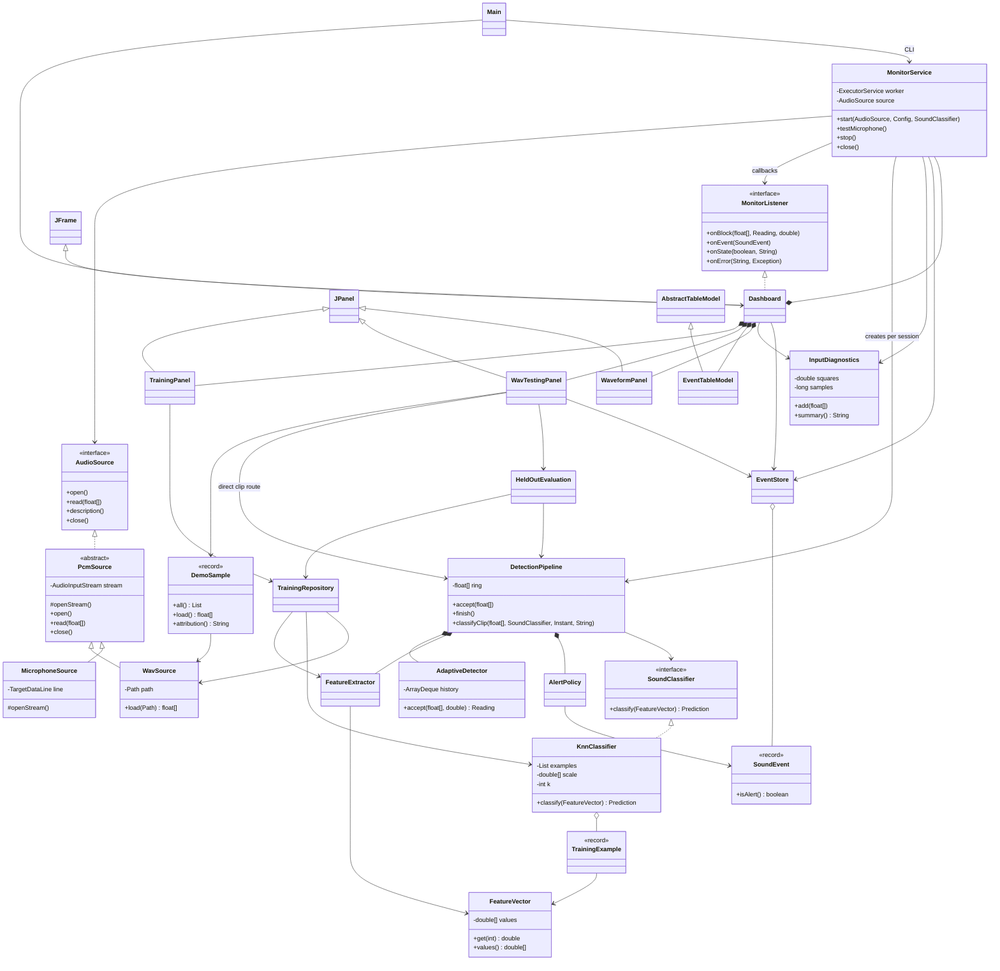

# UML class diagram

Solid triangles denote inheritance; dashed triangles denote interface realization.
Diamonds denote ownership/composition; plain arrows denote use. Method lists are
selected, not exhaustive. Names correspond to `src/omniear/`; Swing/JDK types are
included only where they explain OOP. Mermaid renders directly on GitHub; no
diagram library is needed to build/run the project.

`MonitorListener` is the diagram alias for the nested
`MonitorService.Listener`. `Config`/`Reading` are nested records in
`AdaptiveDetector`; `Prediction` is nested in `SoundClassifier`. `Category`,
`Priority` and `SoundEvent.Status` are enums. `PcmSource` implements
`AudioSource`, which extends `AutoCloseable`; monitor, store and worker panels
also implement `AutoCloseable`. `DarkTheme` and `AudioSamples` are static utility
classes used by presentation/DSP respectively. They are omitted above for clarity.
